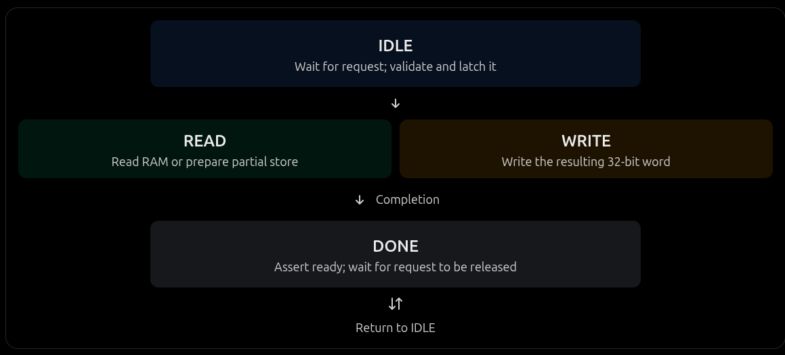

# 3. Implement a multi-cycle memory controller.
Now we're implementing Step 3: the multi-cycle memory controller, which will be your new `data_memory.v`

The controller will sit between the CPU and main_ram.v. 
It will handle the timing and details of memory operations rather than making the CPU interact directly with RAM.

We'll use a four-state FSM:

The operations will take different numbers of cycles:
Instruction	Controller sequence
- LB, LH, LW, LBU, LHU: ----- IDLE → READ → DONE
- SB, SH:---------------------------- IDLE → READ → WRITE → DONE
- SW:--------------------------------- IDLE → WRITE → DONE

Why does SB or SH need an extra state? Your RAM only supports writing an entire 32-bit word. So we must first read the old word, modify the required byte or halfword, and write the complete word back. This is called read-modify-write.

Our RAM has a combinational read and a synchronous write.

For a byte store, for example:
Clock edge	Controller state	What happens
- 1	-- IDLE	--------- Accept request and latch address/data
- 2	-- READ	--------- Read old RAM word and prepare merged data
- 3	-- WRITE--------- 	RAM writes the merged word
- 4	-- DONE	--------- Assert ready

The controller holds ready high until the CPU deasserts req. This will be important when we implement CPU stalling in Step 4.