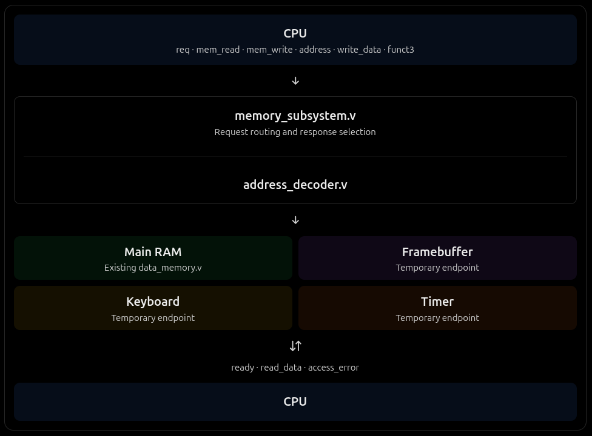

# 1. Implement memory-mapped I/O and address decoding.

## What problem are we solving?

Currently, our CPU can communicate with its 16 KB RAM.
example:
```
sw t0, 0(zero)
lw t1, 0(zero)
```
But imagine we want the CPU to:
- Read keyboard input.
- Write pixels to a display.
- Read a timer.
- Check whether a key has been pressed.

We could create special instructions for each peripheral, but that's unnecessary.

Instead, we'll use memory-mapped I/O (MMIO).

The idea is simple:

We assign addresses to hardware devices. The CPU communicates with those devices using ordinary lw, sw, lb, and sb instructions. for example

```
sw t0, 0(zero)             # Write to RAM
lw t1, 0(zero)             # Read from RAM

lw t2, 0x20000000(zero)    # Read keyboard register
sw t3, 0x10000000(zero)    # Write framebuffer
```

The CPU doesn't need to know whether an address belongs to RAM or a peripheral.

An address decoder handles that.


## Proposed Memory Map

We'll begin with this memory map:

| Address range             | Size  | Device      |
| ------------------------- | ----- | ----------- |
| `0x00000000 – 0x00003FFF` | 16 KB | Main RAM    |
| `0x10000000 – 0x10012BFF` | 75 KB | Framebuffer |
| `0x20000000 – 0x2000000F` | 16 B  | Keyboard    |
| `0x20000010 – 0x2000001F` | 16 B  | Timer       |


The framebuffer allocation assumes 320 × 240 pixels, with 8 bits per pixel.

These ranges are non-overlapping, and we'll use them as our initial hardware/software interface.

## New Architecture
THIS IS HOW IT WAS TILL NOW:


THIS IS HOW IT IS GOING TO BE FROM NOW:

<!--  -->



The address decoder determines which device should receive a request.

For example:

```
CPU sends address: 0x20000000
                |
                v
         Address decoder
                |
                v
          Keyboard selected
```


## What does this module actually do? `address_decoder.v`
It is a purely combinational circuit.

It doesn't store anything, doesn't wait for a clock, and doesn't perform memory operations.

It only looks at the address and determines the destination.

For example

| Input address | RAM | Framebuffer | Keyboard | Timer | Valid |
| ------------- | --- | ----------- | -------- | ----- | ----- |
| `0x00000004`  | 1   | 0           | 0        | 0     | 1     |
| `0x10000004`  | 0   | 1           | 0        | 0     | 1     |
| `0x20000000`  | 0   | 0           | 1        | 0     | 1     |
| `0x20000010`  | 0   | 0           | 0        | 1     | 1     |
| `0x30000000`  | 0   | 0           | 0        | 0     | 0     |