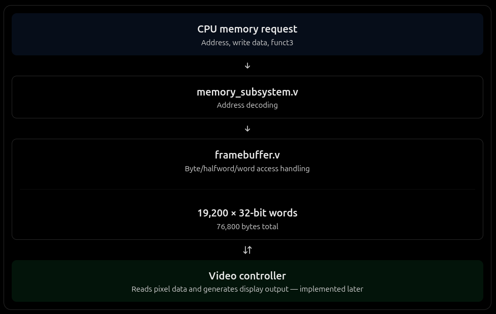

# 2. Design the framebuffer and pixel addressing scheme.

The objective is to let a program running on your RISC-V CPU draw something by writing pixel values into memory. Eventually, the FPGA's video controller will continuously read that memory and display the image on your monitor.

## Design the framebuffer memory organization
### 1. What exactly is a framebuffer?
A framebuffer is simply a region of memory where each memory location represents a pixel on the screen.
For our initial design, we'll use:

320 × 240 display

Horizontal pixels
320

Vertical pixels
240

### 2. How are pixels stored?
Each pixel has an (x, y) coordinate:
- x ranges from 0 to 319.
- y ranges from 0 to 239.
- (0, 0) is the top-left pixel.
- (319, 239) is the bottom-right pixel.

But memory is linear, not two-dimensional. So we need to convert (x, y) into a linear memory offset.


### 3. Convert pixel coordinates into a memory address
Every row contains 320 pixels. Therefore, the number of pixels preceding row y is:
```
y * 320
```

Add the horizontal position:
```
pixel_offset = y*320 + x
```


Since each pixel occupies one byte:
```
pixel_address = 0x10000000 + y*320 + x
```

| Coordinate | Offset | Address      |
| ---------- | ------ | ------------ |
| (0, 0)     | 0      | `0x10000000` |
| (1, 0)     | 1      | `0x10000001` |
| (319, 0)   | 319    | `0x1000013F` |
| (0, 1)     | 320    | `0x10000140` |
| (10, 10)   | 3210   | `0x10000C8A` |
| (319, 239) | 76799  | `0x10012BFF` |


For any pixel offset:
```
word_index = pixel_offset >> 2
byte_lane = pixel_offset & 3
```


### 4. Proposed frame buffer architecutre

